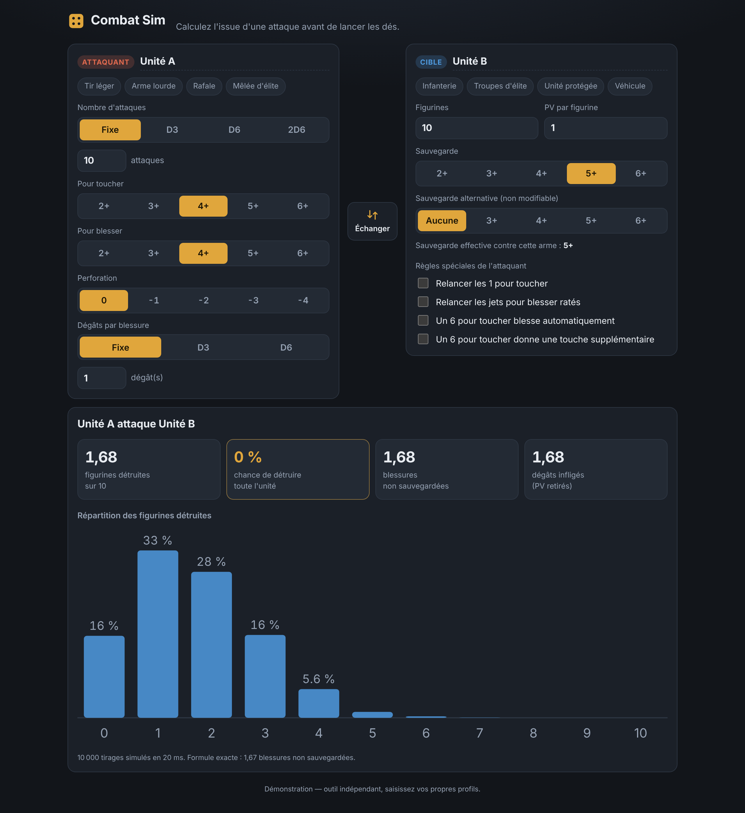

# Combat Sim

Simulateur de combat pour jeux de figurines : saisissez le profil d'une attaque et celui de la cible, et obtenez instantanément les dégâts moyens, le nombre de figurines détruites, la probabilité de détruire toute l'unité et la répartition complète des résultats (10 000 tirages Monte-Carlo).

**Démo en ligne : https://sdfpapillon.github.io/combat-sim/**



## Fonctionnalités

- Règles de la 10e édition : Force contre Endurance, PA, sauvegarde invulnérable, couvert, Insensible à la douleur, -1 aux dégâts.
- Plusieurs armes par unité (profil type fiche : Nb, A, CT/CC, F, PA, D), chacune activable, dupliquable ; dégâts moyens par arme.
- Expressions de dés libres pour les attaques et les dégâts : `3`, `D6`, `2D6`, `D3+1`, `D6+2`…
- Mots-clés d'armes : Torrent, Touches fatales, Touches soutenues X, Blessures dévastatrices, Jumelée, Explosion, Anti-X, Fusion X, Ignore le couvert, touche critique sur 5+/4+.
- Modificateurs (+1/-1 pour toucher et blesser) et relances (les 1 ou les échecs) au niveau de l'unité.
- Dégâts appliqués figurine par figurine, sans report des dégâts en excès ; la figurine blessée reste ciblée d'une arme à l'autre.
- Unités enregistrées dans le navigateur (« Mes unités »), état conservé entre deux visites, bouton « Copier le lien » pour partager une configuration.
- Probabilité de détruire au moins N figurines, en plus de l'histogramme.
- Aucun backend, utilisable sur téléphone.

## Lancer en local

```bash
npm install
npm run dev      # serveur de développement
npm test         # tests du moteur (Vitest)
npm run build    # version de production dans dist/
```

## Structure

- `src/engine.js` — moteur de calcul pur (probabilités, allocation des dégâts, Monte-Carlo), sans dépendance.
- `tests/engine.test.js` — tests de référence (formule exacte, F contre E, sauvegardes, mots-clés, Monte-Carlo).
- `src/App.vue` — interface (Vue 3 + Vite), histogramme en SVG fait main.
- `.github/workflows/deploy.yml` — tests puis déploiement automatique sur GitHub Pages à chaque push sur `main`.

Outil indépendant : aucun profil préenregistré, l'utilisateur saisit ses propres caractéristiques.
